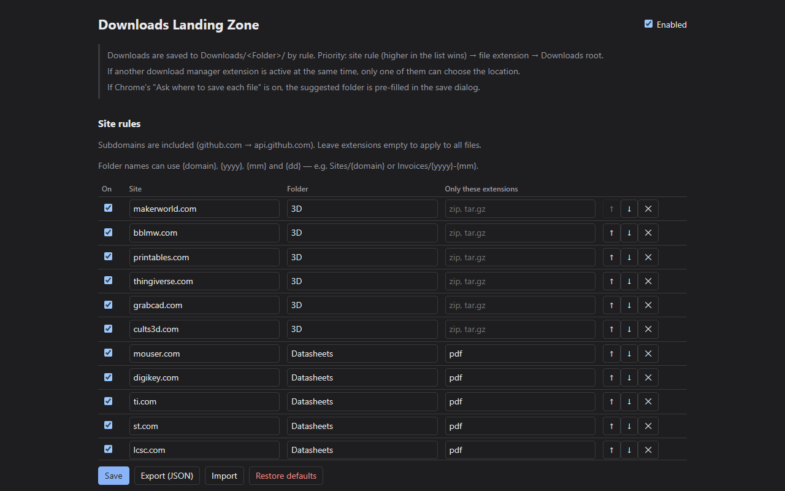
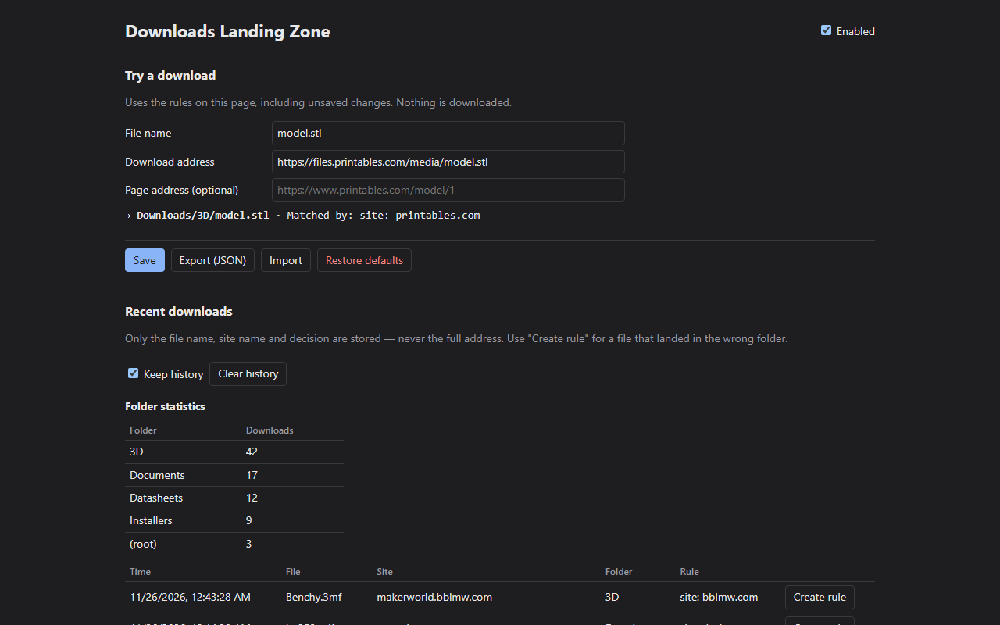

# Downloads Landing Zone

Chrome / Edge extension that saves each download into a subfolder by source site and file type — at download time, nothing is moved afterwards.

## How it decides
1. **Site rules** — makerworld / printables / thingiverse → `3D`, GitHub source archives → `Repos`, datasheet PDFs from Mouser, Digi-Key, TI… → `Datasheets`. Subdomains and download CDNs are recognised.
2. **File type** — installers, archives, documents, images, media, firmware, disk images and code each get their own folder.
3. Anything else stays in the Downloads root.

## Features
- Add, remove, reorder and switch off rules; limit a site rule to certain extensions.
- Folder names can use `{domain}`, `{yyyy}`, `{mm}`, `{dd}` — e.g. `Sites/{domain}`, `Invoices/{yyyy}-{mm}`.
- "Try a download" preview, per-folder statistics, recent downloads with one-click "Create rule".
- Export / import rules as JSON. English and Turkish UI.

## Install
- **Chrome Web Store:** coming soon.
- **Manual (from [Releases](https://github.com/kalkanozgur/downloads-sorter/releases/latest)):** download the `-chrome.zip` (or `-edge.zip`), extract it to a folder, open `chrome://extensions` (`edge://extensions`), turn on **Developer mode**, click **Load unpacked** and pick the folder.

## Privacy
Only `downloads` and `storage` permissions. No network requests, no analytics, no remote code. The optional history keeps only file name and site name. Full text: [Privacy Policy](privacy/).

## Support
[Issues](https://github.com/kalkanozgur/downloads-sorter/issues)

---
Source code is developed in a private repository; this repository hosts the public pages and releases.
